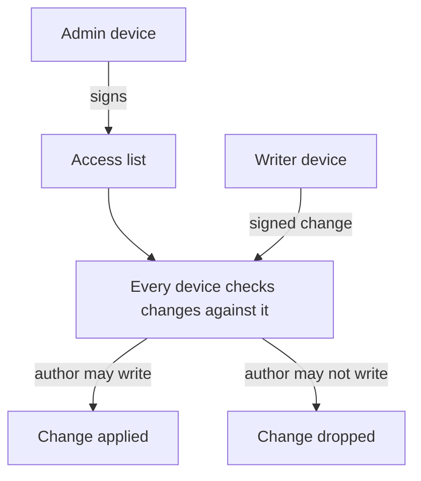

# Sharing a Local congregation (proposal)

A **Local** congregation keeps its data off every cloud. Several people still need to work on it:
the secretary on reports, a brother on the audio schedule. This page proposes how they share data
without a server, and how permissions work when nothing central can enforce them.

Status: reviewed on 2026-11-18 (decisions at the end). **Built:** the encrypted backup (section *Backup*). **Later:** packages for sharing and nearby sync, documented here so the design is not lost.

## The problem

In Cloud mode the server checks permissions on every read and write (R-241). A Local congregation
has no server. The code is public, so anyone can build a modified app that ignores the rules on
their own device. Permissions therefore cannot be checks in the app alone. They must hold **even
against a modified app**.

## The idea: permissions become cryptography

| Permission | Enforced by | What a modified app can still do |
|---|---|---|
| **Read** a kind of data | The device only ever **receives the keys** of what it may read. Data is encrypted per key domain (6.2); the rest stays unreadable, even if the bytes arrive. | Read what it was given. Nothing more. |
| **Write** a kind of data | Every change is **signed** by its author's device key. Every other device checks the signature against the **access list** and **drops** changes the author may not make. | Change its own copy. The change never reaches anyone else. |
| **Admin** | Only administrators can sign the **access list**: who is a member, their device keys and their permissions. | Nothing: an unsigned access list is ignored. |

The **access list** is one small record, signed by an administrator (ML-DSA-65 + Ed25519, D-05),
with a version number. Each device keeps the newest valid version. It is the local equivalent of
the server's memberships.

## One sync format, three ways to carry it

Both of your ideas carry the **same thing**: a bundle of signed, encrypted changes (a *change set*)
plus the newest access list. Each device merges a change set the same way, whatever brought it.

| Transport | How | Platforms | Good for |
|---|---|---|---|
| **Encrypted package (file)** | "Share" creates a file; the other person imports it. The sender chooses what goes in (for example only *Audio, video and stage*), limited to what the receiver may read. The file is encrypted to the receiver's device key, so a lost file is unreadable. | All, including web | First sharing, rare updates, people far away |
| **Nearby devices (peer to peer)** | Installed apps on the same network find each other (mDNS) and exchange change sets directly and encrypted. | Windows, macOS, Linux, Android, iOS | Daily work at the Kingdom Hall or at home |
| **Pairing by QR code (web)** | Browsers cannot discover devices or listen on the network. Two devices connect by scanning each other's QR code (WebRTC on the local network, no server). | Web | When a browser user is in the same room |

**Joining:** an administrator adds a person's device by scanning its QR code in person (or by an
invite package). That adds the device key and its permissions to the access list. Without that,
other devices ignore the new device completely.

**Conflicts:** each change carries a hybrid logical clock (a timestamp that still orders changes
correctly when clocks differ). When two people change the same record, the newest change wins
per field; when that would lose data (both changed the same field), the app keeps both and asks a
person with write permission.

**Removing someone:** an administrator publishes a new access list without them and rotates the
keys they held (as in R-246). Their device keeps what it already had; it gets nothing new, and its
changes are dropped. The app says this clearly, as in Cloud mode.

## What changes for the user

| Today (R-244) | With this proposal |
|---|---|
| Local = one user on one device, all permissions. | Local = any number of devices, each with permissions, sharing by package or nearby sync. Alone on one device, nothing changes. |
| Permissions screen says "only you". | Permissions work as in Cloud. Each person needs the app on their own device (there are no accounts on a server, only device keys). |

## Trade-offs, honestly

- **Slower to agree:** two devices see each other's changes only after they sync (package or
  nearby). Schedules can briefly differ.
- **Administrators hold the keys:** if every administrator's device is lost, nobody can change the
  access list. A recovery package for administrators (like R-311) is needed.
- **Web is limited:** a browser cannot sync in the background or discover devices; it needs a
  package or QR pairing each time.
- **Effort:** the signed change log is the main work. It is also what Cloud sync (D-03, "Sync
  later") needs, so it is not wasted.

## What a person may send: pages and their reference data

A person may share only what they may read. But a page rarely stands alone: to schedule the video
team you need the **names** of the people who may do video and their **absences**, even without
any permission on *All users*. So each page declares the small, read-only **reference data** it
needs, and reading a page includes reading its reference data:

| Page | Its own data | Reference data it needs (read-only) |
|---|---|---|
| Audio, video and stage | Its schedules | Names of the people with the *Audio*, *Video* or *Stage* privilege; their absences |
| Attendants, Microphones | Their schedules | Names of the people with that privilege; their absences |
| Cleaning | Cleaning groups and rota | Names of the people with the *Cleaning* privilege; families (to clean together) |
| Midweek meeting | The schedule | Names, gender and the midweek privileges of everyone eligible; absences |
| Field service reports (own group) | Reports of the group | Names of the group's members |

Reference data is the minimum: names and the privileges or absences that matter for that page,
never contact details, notes or reports. It is kept in its own key domain (`directory`, as
proposed for group rosters in M-09), so a device can hold it without holding the `people` key.

A **package** for page X then contains the data of X and its reference data, encrypted to the
receiving device, and the receiver keeps only what its own permissions allow.

## Backup

Built now, in the congregation *Settings* (cog in the congregation switcher) (administrators):

| Action | What happens |
|---|---|
| **Create backup** | One file (`.theobackup`) with everything in the congregation: people, families, groups, reports, privileges, permissions, settings and the activity log. Encrypted with the congregation password: Argon2id (64 MiB, 3 passes, 4 lanes, R-301) and XChaCha20-Poly1305 (`theo-crypto`). The file header (format version, Argon2 parameters, salt, nonce) is authenticated, so it cannot be weakened. |
| **Restore backup** | Choose the file, type the password it was made with. It **replaces all data** of the open congregation on this device; the storage mode, the current congregation password and biometric unlock stay. A wrong password or a changed file is refused. |

Both are recorded in the activity log. A backup is also how a Local congregation moves to a new
device today.

## Decisions (2026-11-18)

| # | Question | Decision |
|---|---|---|
| S1 | Packages and nearby sync? | Later. Documented here; the signed change log comes first when we build it. |
| S2 | May non-administrators send packages? | Yes, only pages they may read, with the reference data those pages need (see above). |
| S3 | A full encrypted backup? | Yes, built: create and restore in the congregation *Settings* (cog in the congregation switcher); restoring replaces everything. |
| S4 | How many administrators? | One is enough. The app warns that losing that device means nobody can change the access list; the backup is the safety net. |
| S5 | Web users? | Packages only at first; QR pairing later if needed. |
