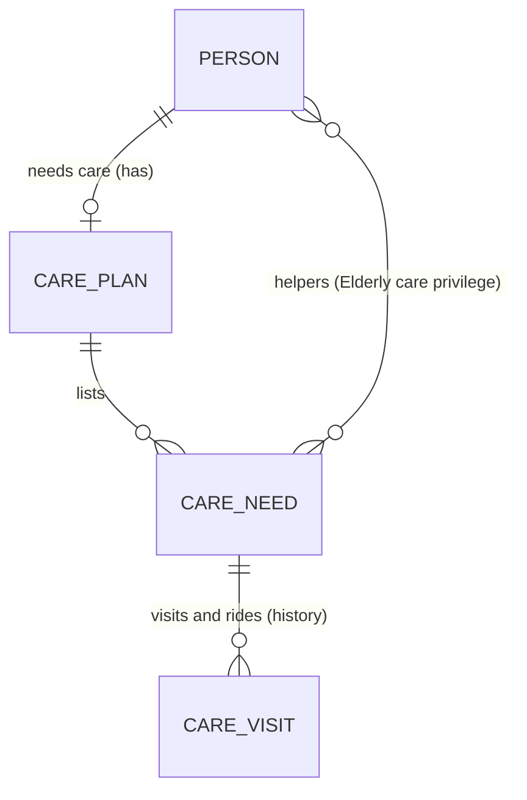

# M-14 Elderly care

Some older ones need help to stay close to the congregation: a ride to the meetings, regular visits,
or help with shopping and appointments. *Users › Elderly care* organises that help: who needs it,
what help, who gives it, and when.

Status: **proposal for review** (2026-11-18). Nothing is built yet beyond the menu entry. The
questions at the end decide the model.

## Proposal

| Record | Fields | Notes |
|---|---|---|
| Care plan | person, contact notes, start date, active | One per person who needs care. Infirm publishers (M-01) are proposed first. |
| Care need | kind (transport to meetings, visit, shopping, medical appointments, other), how often (each meeting, weekly, every two weeks, monthly, once), helpers | Helpers are people with the **Elderly care** privilege. |
| Visit or ride | date, need, helper, done or not, note | The history; shows when the last visit was and who is due next. |

**Screens (proposal):** a list of the people who need care, with filters (kind of help, group,
"no visit in the last N weeks"); the care plan page with its needs and helpers; and a week view of
the rides to the next meetings.

## Questions

| # | Question | Proposal |
|---|---|---|
| E1 | Which kinds of help do you organise? | Transport to meetings, visits, shopping, medical appointments, other. |
| E2 | Transport: is a driver assigned for every meeting (a rota), or is it a standing arrangement (Brother X always drives Sister Y)? | Both: a standing driver, with a rota where needed. |
| E3 | Visits: is a fixed rhythm enough (for example every two weeks), with a warning when a visit is overdue? | Yes. |
| E4 | Should the helper record each visit or ride (history), or is the plan enough? | Record visits; rides only when they did not happen. |
| E5 | Who may see care plans? They can hold health information (special category data, R-020). | Only users with a care permission; notes stay short. |
| E6 | Can a person who needs care be someone outside the congregation's publishers (for example a relative)? | No, only people in M-01. |
